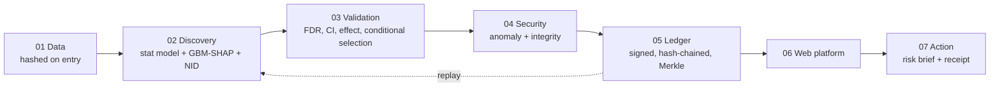

# SYNERA: Trusted AI for Multi-Stressor Environmental Intelligence

> **DISCOVER. VALIDATE. VERIFY. ACT.** · Team PeakyGliders, Guru Nanak Dev University

Environmental stressors (heat, air pollution, drought, extreme weather, radiation, microgravity) interact, yet most analysis studies them one at a time.
SYNERA uses AI to **discover** interaction hypotheses, classical statistics to **validate** them, cybersecurity and cryptographic provenance to **verify** the computational chain, and turns validated findings into **decision support**.

> *AI generates hypotheses. Science validates them. The ledger does not prove the science; it makes the computational provenance tamper-evident.*

## What is in the box

| Layer | What it does | Where |
|---|---|---|
| 01 Data | NASA OSDR omics, Open-Meteo weather and air quality, **CDC weekly deaths + EPA air monitors (real health outcome)**, Natural Earth; every file hashed and registered on entry | `src/synera_core/data`, `scripts/build_data.py`, `scripts/build_health_panel.py` |
| 02 AI discovery | Panel-aware interaction test for every stressor pair, plus independent LightGBM-SHAP and neural-interaction second opinions; factorial OLS with empirical-Bayes moderation for omics | `src/synera_core/discovery` |
| 03 Validation | BH-FDR, conditional selection (removes look-alike pairs), block-bootstrap intervals, effect-size gate, replication | `src/synera_core/validation`, `discovery/panel.py` |
| 04 Cybersecurity | Baseline-calibrated anomaly detectors, model verification, source-drift detection, replay, tamper simulator | `src/synera_core/security` |
| 05 Provenance | SHA-256, Merkle proofs, signed (Ed25519) hash-chained append-only ledger | `src/synera_core/provenance` |
| 06 Web platform | FastAPI + React (NASA Earth observatory, evidence dossiers, Trust Center) | `backend/`, `frontend/` |
| 07 Action | Compound-risk brief with uncertainty, sources and a reproducibility receipt; **Scenario Lab**: pick a US state and season, set any mix of heat, weather and air pollution, and get the estimated consequence for deaths with an honest range (a model learned from real data, evaluated live in the browser) | `src/synera_core/risk`, `src/synera_core/prediction`, `frontend/src/app/pages/Scenario.tsx` |



**Live Stress Lab.** A physical Arduino Uno (DHT11 temperature and humidity, MQ gas sensor) read over USB and streamed into the app at `/live-stress-lab`, with a bounded live history, scenario builder, an exploratory heat-index interaction view, a comparison with real historical data and a provenance record for every value. Readings carry `REAL_SENSOR` or `SIMULATED_TEST` provenance; a hardware session can be sealed in the ledger. Setup, wiring, API and honesty rules: [docs/LIVE_STRESS_LAB.md](docs/LIVE_STRESS_LAB.md).

## Quickstart

```bash
make setup        # venv, dependencies, npm ci            (Python 3.11+, Node 20+)
make check        # versions and imports
make data         # hash + register datasets in the ledger (offline after the first run)
make space        # Track A gene-level analysis on the real NASA data
make seed         # run the real pipeline and fill the application database
make benchmark    # engine report card: 26-40 minutes, resumable
make demo         # verify evidence, start API (8000) and web (5173)
```

On Windows without `make`, run `.\dev.cmd` from the repository root: it starts the API (8000) and the web app (5173) with the project's own `.venv` Python, whatever Python is on your PATH. Starting the API by hand? Use the venv: `.venv\Scripts\python.exe -m uvicorn backend.app.main:app --reload` (from the root) or `uvicorn app.main:app --reload` (from `backend/`); a Python without the project's packages now stops with an explanation instead of a traceback.

Or `docker compose up --build` → web on `http://localhost:8080` (the ledger and its signing key live in a named volume, never in an image).
`make reproduce` re-runs every recorded analysis and compares the digest of its outputs with the ledger; mismatches are reported and the exit code is non-zero.

## Deploying

**Free, server-less (Vercel).** The hosted site is a *recorded demo*: `python scripts/build_snapshot.py` runs the real API in a temporary copy of the project and writes every response it gives to `frontend/public/snapshot/` (about 6 MB, committed). A build with `VITE_STATIC=1` (`npm run build:static`) answers every request from those files, so it needs no backend, never sleeps and works from any computer. What it replays is real, recorded output; what it cannot do is compute: "Run the engine", "Launch attack" and "Re-verify" replay the recorded outcome (attacks at 5%, seed 1), and the page says so in a banner and in the top bar (`RECORDED DEMO`). To deploy: import the repo in Vercel with Root Directory `frontend` (`frontend/vercel.json` already sets the build command, output folder and SPA rewrite); no environment variables are needed. After changing the analysis code, re-seed (`make seed`), re-record (`python scripts/build_snapshot.py`), and commit the new `frontend/public/snapshot/` so the hosted numbers match the code.

**Live computation (Docker).** `docker compose up --build` starts two services: `api` (FastAPI, non-root) and `web` (nginx serving the built UI and proxying `/api/` to the API, with response buffering off so the engine's progress stream works).

* **First start** runs `scripts/bootstrap.py --quick`: it registers the datasets, restores the shipped benchmark report from `data/results/`, rebuilds the Track A gene results, seeds the database and generates a fresh ledger signing key. This takes a couple of minutes; the API reports healthy afterwards and `web` waits for it.
* **State** (ledger, signing key, database, results) lives in the `artifacts` volume. Keep the volume: delete it and every ledger block, the key and all findings are regenerated, so earlier receipts will no longer verify. The key is never in git or an image.
* **Settings** (environment): `CORS_ORIGINS` must list the public origin of the site; `SYNERA_OFFLINE=1` serves cached forecasts and never calls out. With internet access the Risk Brief fetches a live Open-Meteo forecast, and falls back to a cached one when that fails.
* **HTTPS** is not terminated here. Put the `web` service behind your host's TLS (a load balancer, Caddy or a platform proxy) and expose only port 8080/443, not 8000.
* **After changing anything in `src/synera_core`**, re-run `make seed` (or recreate the volume): the code fingerprint changes, and the reproducibility gate correctly reports older runs as stale.
* **Refreshing the benchmark**: `make benchmark`, then copy `artifacts/results/benchmark.json` to `data/results/benchmark.json` and commit it.
* **Everything the site shows about risk is a simulated demonstration** and says so on the page. No finding is VERIFIED.

## The finding lifecycle

`CANDIDATE` survived FDR and conditional selection → `VALIDATED` effect ≥ the pre-specified gate, bootstrap CI clears it, ≥ 2 of 3 methods agree → `VERIFIED` additionally replicated (in an independent dataset, or kept again by the engine on later data that was not used to find it: `LATER_DATA_REPLICATION`), built from REAL data, dataset hash and ledger chain intact, and the run replays to the same result. `BLOCKED` = any integrity failure ("result blocked from verified status"). `REJECTED` = detectable but below the minimal effect.
**VERIFIED means "statistically validated with verified computational provenance". It never means "biologically proven."** Every gate (G1–G8) is evaluated live and shown with its reason in the UI.

## Datasets and licences

| Track | Data | Source | Notes |
|---|---|---|---|
| A (REAL) | OSD-211 spleen and OSD-237 skin RNA-seq, radiation × hindlimb unloading, n = 6/6/3/6 | NASA Open Science Data Repository / GeneLab | public; the two studies share 20 of 21 animals |
| B (covariates REAL, outcome SIMULATED) | 8 cities × 518 days of weather and air quality | Open-Meteo archives | CC BY 4.0; outcome is generated with known planted interactions |
| C (REAL outcome) | Weekly all-cause, heart-disease and stroke deaths for 38 to 46 US states, 2014 to 2019 (14,065 complete state-weeks), joined to the weather and air pollution each state experienced | CDC NCHS (public domain); US EPA Air Quality System monitors (public domain); Open-Meteo / ERA5 (CC BY 4.0); NASA POWER UV index (public domain) | built by `scripts/build_health_panel.py`; the processed panels are tracked, raw downloads are not; COVID-19 years are excluded on purpose |
| D (REAL, not health) | Daily electricity supplied to 16 Indian states (Grid-India), 2019 to April 2024, joined to state-level ERA5 weather; two panels of 8 states each (`india_grid`, `india_grid_b`), about 15,000 state-days each | Hunt and Bloomfield, Zenodo 10.5281/zenodo.14983362 (CC BY 4.0) | built by `scripts/build_india_grid_panel.py`; the outcome measures stress on the power grid, not health; five weather stressors (max temperature, humidity, wind, solar radiation, cloud cover) |
| reference | land polygons; gene symbols; Earth imagery | Natural Earth (public domain); MyGene.info; NASA Visible Earth (public domain) | symbol map is hashed and registered |

## Measured results (all computed; see `artifacts/results/benchmark.json`, `space_biology.json`)

**Engine report card (Track B, SIMULATED; 50 seeds per SNR level; 4 levels).**

| | SNR 1 | SNR 2 | SNR 5 | SNR 20 |
|---|---|---|---|---|
| Marginal pairwise screen: strict FDR | 92.0% | 92.4% | 92.7% | 92.8% |
| After conditional selection: strict FDR | 7.3% | 0.7% | 1.3% | 0.7% |
| **Full stack: strict FDR** | **6.2%** | **0.7%** | **0.0%** | **0.0%** |
| **Full stack: recall of the 3 planted interactions** | **90%** | **97%** | **97%** | **97%** |

* The marginal screen alone is *not* FDR-controlled: omitted interactions leak into correlated pairs and every method flags ~2,000 pairs per 150 datasets. Conditional selection is what removes them.
* Calibration under the null (100 simulations): median inflation factor λ **naive 4.11**, **HAC 14.32** (a 16-restriction Newey-West test is *worse* than naive with persistent regressors), **block bootstrap 1.38** (7.6% of p-values below 0.05 against a nominal 5%: improved, not perfect).
* Typing is weaker than detection: a non-linear surface is typed correctly only 26% (SNR 1) / 44% (SNR 2) of the time, rising to 90–100% at SNR ≥ 5.
* Variance moderation on a simulated 6/6/3/6 design: all three methods hold FDR at 4–5%; data-estimated moderation has marginally the highest power (e.g. 46% vs 41% unmoderated at 3 residual SDs).

**Space biology (Track A, REAL).** 24,688 genes tested in spleen; **no gene passes FDR** (best q = 0.45). Null calibration over 200 permutations: λ = 0.96, 3.5% of p-values < 0.05, 6% of permutations with any hit. A spike-in test on the real matrix shows 43% power for a 1.5 log2 interaction and **80% power only at about 4 log2**, so this design cannot support gene-level interaction claims. Radiation and unloading main effects are not detected either (0 genes at q < 0.05 in spleen). The cross-tissue comparison (spleen vs skin) is `CROSS_TISSUE_SAME_COHORT`: a consistency check, never independent replication.

**Security.** On clean data held out from each detector's baseline (100 random splits), false alarms are 2-5% per statistical detector (isolation forest 3%, MCD 5%, autoencoder 5%, drift 2%) and 10% of clean datasets trigger at least one advisory warning; the physical-range, duplicate and label checks never fired. The cryptographic hash caught 100% of 600 attack trials. Physical-range checks caught every decimal-shift, unit-drift and outlier injection; **subtle in-range edits (+0.3 SD) and flipped labels were caught by no statistical detector in 8 of 20 attack × contamination cells; only the hash saw them.** MCD and the autoencoder never fired at these attack strengths yet raise 5% false alarms each, so they currently add noise, not protection. This is why the hash, not the statistics, is what blocks a result.

**Real health outcomes (Track C and the Scenario Lab; CDC deaths x EPA monitors x ERA5 weather, 2014 to 2019).**

* **What the engine found: no interaction.** For all-cause, heart-disease and stroke deaths the engine tested all 45 stressor pairs; none survived FDR control and conditional selection. An earlier pass that did *not* remove nationwide flu and weather waves had flagged an ozone x UV pattern; it disappeared once each state was compared only with the other states in the same week. A discovery that does not survive the obvious confounder is withdrawn, not reported.
* **What the data do support: separate effects.** Same-week comparisons across states give, for all-cause deaths, **+0.62% per +10 ug/m3 PM2.5** (90% interval 0.34 to 0.83), +0.36% per +10 ug/m3 NO2, +0.09% per +10 ug/m3 ozone, **+0.36% for a heat index 5 C above normal in summer** and **+0.51% for 5 C below normal in winter**; heart-disease deaths respond more strongly (PM2.5 +1.45% per +10 ug/m3, 0.95 to 2.01).
* **How well the model predicts places it never saw** (leave-states-out): calibration slope **0.91 [0.64, 1.22]** all causes, 0.97 [0.81, 1.13] heart disease, 0.93 [0.60, 1.21] stroke (1 = perfect); the riskiest tenth of weeks had +0.51% excess deaths against +0.62% predicted, the safest tenth -0.55% against -0.59%. It explains only **0.7% of week-to-week variation** (flu, ageing and chance dominate) and a gradient-boosting second opinion does no better.
* **Interactions between stressors are small if they exist at all:** on an unshrunken fit, 7 of 45 pair terms differ from zero where about 4.5 are expected by chance, and an extra effect larger than about 0.4% per usual-deviation squared would very likely have been seen.
* The model is a short list of coefficients, evaluated in the browser; `frontend/src/tests/scenario.test.ts` checks the TypeScript against the Python to 9 decimals. It never claims more than its interval: "no clear effect" is shown when the data cannot separate a scenario from a typical week, and conditions far from what a state has experienced are flagged as extrapolation.

**Real Indian electricity demand (Track D; Grid-India daily supply x state ERA5 weather, 2019 to April 2024).**

* Two panels of 8 states (about 15,000 state-days each) run through the unchanged engine with its pre-set rules. On the first panel 7 pairs survive selection (5 VALIDATED, 2 CANDIDATE); on the second, different states, 4 (3 VALIDATED, 1 CANDIDATE). All are non-linear, with effects of 0.06 to 0.19 outcome SD.
* **Maximum temperature x humidity**, **maximum temperature x cloud cover** and **humidity x solar radiation** are kept in both panels (effects 0.14 / 0.18, 0.13 / 0.19 and 0.17 / 0.07 SD). The Discovery Lab shows this check ("Does it repeat in other states?"), computed from the two recorded runs.
* That is a check across states of one data source (the same record supplies demand and weather), so on its own it is INTERNAL_REPLICATION.
* **Later data.** The same engine was then run on the same states after the analysis window (Apr 2024 to Oct 2026, 7,200 state-days per panel, `india_grid_late` and `india_grid_b_late`). On the first 8 states, **temperature x humidity** (synergistic) and **humidity x cloud cover** were kept again and became **VERIFIED**; temperature x sunlight, temperature x cloud cover and humidity x sunlight (still significant but not kept) did not repeat. On the other 8 states none of the originally validated pairs were kept (temperature x humidity stayed significant, not kept).
* Temperature x humidity is significant in all four panels (two sets of states, two periods).

## Limitations and honest claims

* **VERIFIED ≠ biologically proven.** It means statistically validated plus verified provenance.
* **Two findings are VERIFIED, both in Track D, and neither is a health finding.** They are maximum temperature x humidity and humidity x cloud cover in the electricity demand of 8 large Indian states: the engine, with its unchanged rules, kept both again on later data (29 April 2024 to October 2026) that was not used to find them. "Later data" is a different period of the same grid operator's reports (separately compiled), not a different source, and the weather for it is built differently (3-city averages), so the evidence level is `LATER_DATA_REPLICATION`, not `INDEPENDENT_REPLICATION`; accepting it as satisfying check G7 is a rule choice, stated on the finding. Track B findings are simulated and capped at VALIDATED; Track A has nothing that passes FDR; Track C (real deaths) has no interaction finding.
* **Track D is grid stress, not health, and its pairs depend on a choice.** The outcome is electricity supplied. Humidity, sunlight and cloud cover move together, so pairs involving them may describe a weather pattern rather than one mechanism. The analysed outcome stops at the state's own trend, season and weekday; a version that also removes the same-day average of the panel's states was run during development and selected different pairs.
* **Track C is ecological and approximate.** Exposure is one metro area's weather and the state's mean monitor reading (many monitors sample 1 day in 3 or 6), weekly totals hide short spikes, and results are average associations between local conditions and state-week deaths, not individual risk and not proof of cause. Exposure error blurs real effects toward zero, so true effects are probably somewhat larger than shown.
* **Track B is semi-synthetic.** It measures the engine, not nature. Strict FDR counts correlated look-alike pairs as false.
* **Track A is underpowered** (n = 6/6/3/6). Large cell-to-cell variance, a mis-labelled-sample check by sample name only, and tissue differences limit what the tissue pair can show.
* Log2 additivity is multiplicative independence on the fold-change scale. Variance moderation is an approximation of limma (method-of-moments prior), not limma itself.
* HAC inference is reported as a sensitivity check only; the block-bootstrap-calibrated test is primary and slightly anti-conservative (7.6% at nominal 5%).
* The ledger is permissioned and tamper-evident; anchoring the head hash to a public chain is future work. The statistical detectors are advisory and can never block on their own.
* Risk briefs are demonstrations built on simulated findings; the page says so.
* A change to the source tree after a run makes `G4_REPRODUCIBILITY` fail by design (code drift). Re-run `make seed` after editing code.

## Quality gates (last run)

88 Python tests (core, pipeline, tamper, scenario model, India grid, API) · 60 frontend tests, including a check that the TypeScript Scenario predictor matches the Python one to 9 decimals · `ruff` clean · real type-check (`tsc -p tsconfig.app.json`) and production build clean · three Playwright end-to-end suites pass: `npm run e2e` (Observatory → engine run → finding → re-verify → tamper → ledger still valid), `npm run e2e:scenario` (presets, sliders, season effect, outcome and state switching, phone layout) and `npm run e2e:static` (the whole recorded demo with the API switched off) · `make reproduce` reports REPRODUCED for all six analyses and 25/25 registered files match the ledger · 9 notebooks executed headless earlier in the project · `npm audit --omit=dev`: 0 vulnerabilities · pinned Python environment in `requirements.lock`. Not tested here: the Docker images and the hosted Render and Vercel deployments themselves (their build steps were reproduced locally from a clean copy).

## Repository map

`src/synera_core` science and provenance · `backend` FastAPI app and API tests · `frontend` React app · `scripts` build, benchmark, seed, reproduce, demo · `notebooks` 00–08 (thin, executed) · `docs` contract, design system, demo script, screenshots · `configs` settings and dataset registry · `data` processed tables, reference data, `MANIFEST.json` · `artifacts` (git-ignored) ledger, results, database.

See `docs/API_CONTRACT.md`, `docs/DESIGN_SYSTEM.md`, `docs/DEMO_SCRIPT.md`, `PROGRESS.md`.
