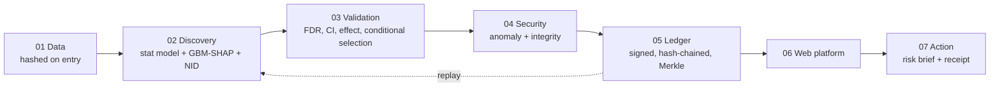

# SYNERA: Trusted AI for Multi-Stressor Environmental Intelligence

> **DISCOVER. VALIDATE. VERIFY. ACT.** · Team PeakyGliders, Guru Nanak Dev University

Environmental stressors (heat, air pollution, drought, extreme weather, radiation, microgravity) interact, yet most analysis studies them one at a time.
SYNERA uses AI to **discover** interaction hypotheses, classical statistics to **validate** them, cybersecurity and cryptographic provenance to **verify** the computational chain, and turns validated findings into **decision support**.

> *AI generates hypotheses. Science validates them. The ledger does not prove the science; it makes the computational provenance tamper-evident.*

## What is in the box

| Layer | What it does | Where |
|---|---|---|
| 01 Data | NASA OSDR omics, Open-Meteo weather and air quality, Natural Earth; every file hashed and registered on entry | `src/synera_core/data`, `scripts/build_data.py` |
| 02 AI discovery | Panel-aware interaction test for every stressor pair, plus independent LightGBM-SHAP and neural-interaction second opinions; factorial OLS with empirical-Bayes moderation for omics | `src/synera_core/discovery` |
| 03 Validation | BH-FDR, conditional selection (removes look-alike pairs), block-bootstrap intervals, effect-size gate, replication | `src/synera_core/validation`, `discovery/panel.py` |
| 04 Cybersecurity | Baseline-calibrated anomaly detectors, model verification, source-drift detection, replay, tamper simulator | `src/synera_core/security` |
| 05 Provenance | SHA-256, Merkle proofs, signed (Ed25519) hash-chained append-only ledger | `src/synera_core/provenance` |
| 06 Web platform | FastAPI + React (NASA Earth observatory, evidence dossiers, Trust Center) | `backend/`, `frontend/` |
| 07 Action | Compound-risk brief with uncertainty, sources and a reproducibility receipt | `src/synera_core/risk` |



## Quickstart

```bash
make setup        # venv, dependencies, npm ci            (Python 3.11+, Node 20+)
make check        # versions and imports
make data         # hash + register datasets in the ledger (offline after the first run)
make space        # Track A gene-level analysis on the real NASA data
make seed         # run the real pipeline and fill the application database
make benchmark    # engine report card: 26-40 minutes, resumable
make demo         # verify evidence, start API (8000) and web (5173)
```

Or `docker compose up --build` → web on `http://localhost:8080` (the ledger and its signing key live in a named volume, never in an image).
`make reproduce` re-runs every recorded analysis and compares the digest of its outputs with the ledger; mismatches are reported and the exit code is non-zero.

## Deploying

`docker compose up --build` starts two services: `api` (FastAPI, non-root) and `web` (nginx serving the built UI and proxying `/api/` to the API, with response buffering off so the engine's progress stream works).

* **First start** runs `scripts/bootstrap.py --quick`: it registers the datasets, restores the shipped benchmark report from `data/results/`, rebuilds the Track A gene results, seeds the database and generates a fresh ledger signing key. This takes a couple of minutes; the API reports healthy afterwards and `web` waits for it.
* **State** (ledger, signing key, database, results) lives in the `artifacts` volume. Keep the volume: delete it and every ledger block, the key and all findings are regenerated, so earlier receipts will no longer verify. The key is never in git or an image.
* **Settings** (environment): `CORS_ORIGINS` must list the public origin of the site; `SYNERA_OFFLINE=1` serves cached forecasts and never calls out. With internet access the Risk Brief fetches a live Open-Meteo forecast, and falls back to a cached one when that fails.
* **HTTPS** is not terminated here. Put the `web` service behind your host's TLS (a load balancer, Caddy or a platform proxy) and expose only port 8080/443, not 8000.
* **After changing anything in `src/synera_core`**, re-run `make seed` (or recreate the volume): the code fingerprint changes, and the reproducibility gate correctly reports older runs as stale.
* **Refreshing the benchmark**: `make benchmark`, then copy `artifacts/results/benchmark.json` to `data/results/benchmark.json` and commit it.
* **Everything the site shows about risk is a simulated demonstration** and says so on the page. No finding is VERIFIED.

## The finding lifecycle

`CANDIDATE` survived FDR and conditional selection → `VALIDATED` effect ≥ the pre-specified gate, bootstrap CI clears it, ≥ 2 of 3 methods agree → `VERIFIED` additionally replicated independently, built from REAL data, dataset hash and ledger chain intact, and the run replays to the same result. `BLOCKED` = any integrity failure ("result blocked from verified status"). `REJECTED` = detectable but below the minimal effect.
**VERIFIED means "statistically validated with verified computational provenance". It never means "biologically proven."** Every gate (G1–G8) is evaluated live and shown with its reason in the UI.

## Datasets and licences

| Track | Data | Source | Notes |
|---|---|---|---|
| A (REAL) | OSD-211 spleen and OSD-237 skin RNA-seq, radiation × hindlimb unloading, n = 6/6/3/6 | NASA Open Science Data Repository / GeneLab | public; the two studies share 20 of 21 animals |
| B (covariates REAL, outcome SIMULATED) | 8 cities × 518 days of weather and air quality | Open-Meteo archives | CC BY 4.0; outcome is generated with known planted interactions |
| reference | land polygons; gene symbols; Earth imagery | Natural Earth (public domain); MyGene.info; NASA Visible Earth (public domain) | symbol map is hashed and registered |

## Measured results (all computed; see `artifacts/results/benchmark.json`, `space_biology.json`)

**Engine report card (Track B, SIMULATED; 50 seeds per SNR level; 4 levels).**

| | SNR 1 | SNR 2 | SNR 5 | SNR 20 |
|---|---|---|---|---|
| Marginal pairwise screen: strict FDR | 92.0% | 92.4% | 92.7% | 92.8% |
| After conditional selection: strict FDR | 7.3% | 0.7% | 1.3% | 0.7% |
| **Full stack: strict FDR** | **6.2%** | **0.7%** | **0.0%** | **0.0%** |
| **Full stack: recall of the 3 planted interactions** | **90%** | **97%** | **97%** | **97%** |

* The marginal screen alone is *not* FDR-controlled: omitted interactions leak into correlated pairs and every method flags ~2,000 pairs per 150 datasets. Conditional selection is what removes them.
* Calibration under the null (100 simulations): median inflation factor λ **naive 4.11**, **HAC 14.32** (a 16-restriction Newey-West test is *worse* than naive with persistent regressors), **block bootstrap 1.38** (7.6% of p-values below 0.05 against a nominal 5%: improved, not perfect).
* Typing is weaker than detection: a non-linear surface is typed correctly only 26% (SNR 1) / 44% (SNR 2) of the time, rising to 90–100% at SNR ≥ 5.
* Variance moderation on a simulated 6/6/3/6 design: all three methods hold FDR at 4–5%; data-estimated moderation has marginally the highest power (e.g. 46% vs 41% unmoderated at 3 residual SDs).

**Space biology (Track A, REAL).** 24,688 genes tested in spleen; **no gene passes FDR** (best q = 0.45). Null calibration over 200 permutations: λ = 0.96, 3.5% of p-values < 0.05, 6% of permutations with any hit. A spike-in test on the real matrix shows 43% power for a 1.5 log2 interaction and **80% power only at about 4 log2**, so this design cannot support gene-level interaction claims. Radiation and unloading main effects are not detected either (0 genes at q < 0.05 in spleen). The cross-tissue comparison (spleen vs skin) is `CROSS_TISSUE_SAME_COHORT`: a consistency check, never independent replication.

**Security.** On clean data held out from each detector's baseline (100 random splits), false alarms are 2-5% per statistical detector (isolation forest 3%, MCD 5%, autoencoder 5%, drift 2%) and 10% of clean datasets trigger at least one advisory warning; the physical-range, duplicate and label checks never fired. The cryptographic hash caught 100% of 600 attack trials. Physical-range checks caught every decimal-shift, unit-drift and outlier injection; **subtle in-range edits (+0.3 SD) and flipped labels were caught by no statistical detector in 8 of 20 attack × contamination cells; only the hash saw them.** MCD and the autoencoder never fired at these attack strengths yet raise 5% false alarms each, so they currently add noise, not protection. This is why the hash, not the statistics, is what blocks a result.

## Limitations and honest claims

* **VERIFIED ≠ biologically proven.** It means statistically validated plus verified provenance.
* **No finding is VERIFIED today.** Track B findings are simulated and capped at VALIDATED; Track A has nothing that passes FDR and no independent replication set.
* **Track B is semi-synthetic.** It measures the engine, not nature. Strict FDR counts correlated look-alike pairs as false.
* **Track A is underpowered** (n = 6/6/3/6). Large cell-to-cell variance, a mis-labelled-sample check by sample name only, and tissue differences limit what the tissue pair can show.
* Log2 additivity is multiplicative independence on the fold-change scale. Variance moderation is an approximation of limma (method-of-moments prior), not limma itself.
* HAC inference is reported as a sensitivity check only; the block-bootstrap-calibrated test is primary and slightly anti-conservative (7.6% at nominal 5%).
* The ledger is permissioned and tamper-evident; anchoring the head hash to a public chain is future work. The statistical detectors are advisory and can never block on their own.
* Risk briefs are demonstrations built on simulated findings; the page says so.
* A change to the source tree after a run makes `G4_REPRODUCIBILITY` fail by design (code drift). Re-run `make seed` after editing code.

## Quality gates (last run)

75 Python tests (core, pipeline, tamper, API) · 45 frontend tests · `ruff` clean · `tsc` and production build clean · Playwright end-to-end smoke (`npm run e2e`: Observatory → engine run → finding → re-verify → tamper → ledger still valid) passes · 9 notebooks execute headless without errors · `make reproduce` reports REPRODUCED · `npm audit --omit=dev`: 0 vulnerabilities · pinned Python environment in `requirements.lock`.

## Repository map

`src/synera_core` science and provenance · `backend` FastAPI app and API tests · `frontend` React app · `scripts` build, benchmark, seed, reproduce, demo · `notebooks` 00–08 (thin, executed) · `docs` contract, design system, demo script, screenshots · `configs` settings and dataset registry · `data` processed tables, reference data, `MANIFEST.json` · `artifacts` (git-ignored) ledger, results, database.

See `docs/API_CONTRACT.md`, `docs/DESIGN_SYSTEM.md`, `docs/DEMO_SCRIPT.md`, `PROGRESS.md`.
